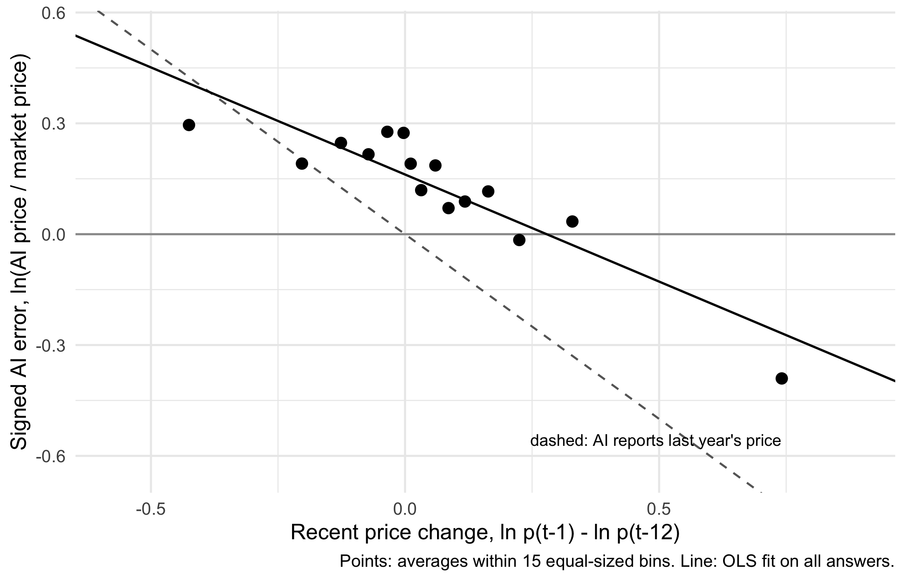

# Does AI know local prices? A pilot on 21 low- and middle-income countries

**Question.** When a large language model gives local economic information about a developing country, how wrong is it, and why?
Does the error grow as countries get poorer ("the AI was trained on rich-country data"), or does it follow something else?

**Design.** I asked `gpt-4.1-mini` (temperature 0, two repeats) for the average local retail price of six staple foods
(maize, rice, wheat flour, beans, sugar, cooking oil) in 21 low- and middle-income countries, in 8 months of 2023–24:
908 price questions, 1,816 answers. The correct answer is the median retail price across markets reported by the
World Food Programme (WFP). The error is the log distance between the model's price and the market price.

## Main findings

| | Estimate | Wild cluster bootstrap p |
|---|---|---|
| Error, low-income vs upper-middle-income countries | −0.05 log points | 0.40 |
| Error, lower-middle- vs upper-middle-income countries | −0.06 log points | 0.36 |
| Signed error on the product's price change in the previous year | **−0.65** | **0.002** |
| Same, with country fixed effects | −0.45 | 0.001 |
| Same, without Nigeria and Malawi | −0.36 | 0.002 |
| Same, leave-one-country-out (21 runs) | −0.46 to −0.70 | min \|t\| = 3.7 |
| Placebo: arithmetic questions on currency depreciation | −0.14 | 0.08 |

1. **No income gradient.** Within developing countries, the model is not less accurate for poorer ones.
2. **Stale knowledge.** When a product's local price had changed over the previous year, the model missed roughly
   35–65% of that change: it under-estimates prices that rose and over-estimates prices that fell.
   The effect holds within countries over time, without the two largest-shock countries, and after dropping any single country.
3. The mismatch is therefore **temporal** rather than about income level: it matters most where inflation and devaluation are high.

## Methods in one paragraph

Regressions of the error on the regressors of interest with product × month fixed effects (each country is compared with
other countries asked about the same product in the same month). Standard errors are clustered by country (21 clusters).
Because 21 clusters is few, p-values come from a restricted wild cluster bootstrap with Webb six-point weights
(9,999 draws), written by hand in `04_analyse.R`. The recent price change is measured as ln p(t−1) − ln p(t−12), leaving out
the question month so that measurement noise in the benchmark cannot create a mechanical correlation with the error.

## Reproduce

1. Download into `data_raw/` (not included in this repository):
   - WFP food prices for each country, `wfp_food_prices_<iso3>.csv`, from the Humanitarian Data Exchange (data.humdata.org);
   - World Bank `OGHIST.xlsx` (historical income groups) and `CLASS.xlsx` (regions);
   - World Bank WDI GNI per capita, Atlas method (`API_NY.GNP.PCAP.CD_*.csv`).
2. Put an OpenAI key in a file `.Renviron` as `OPENAI_API_KEY=...` (never commit it). Only needed for step 03.
3. Run the scripts in order in R (4.3 or later):

| Script | What it does |
|---|---|
| `00_setup.R` | installs packages, creates folders |
| `00_test_api.R` | checks the API key with one test question |
| `01_build_benchmark.R` | WFP prices → one true price per country × product × month, income group in force that month |
| `01b_check_coverage.R` | diagnostics: why some countries drop out |
| `02_make_questions.R` | turns benchmark cells into 908 price questions + 168 arithmetic control questions |
| `03_query_models.R` | sends every question twice to the model; resumable; raw answers in `logs/` |
| `04_analyse.R` | error measures, income regressions, robustness R1–R7, wild cluster bootstrap |
| `05_shocks.R` | recent price change and currency depreciation; stale-knowledge regressions |
| `06_robustness.R` | country FE, without Nigeria/Malawi, actual prices only, controls, leave-one-out |

Model answers are saved in `data_clean/responses.csv`, so steps 04–06 run without an API key.

## Limitations

- One model, one prompt, English only; 21 countries; no high-income comparison group yet.
- The questions simulate a user asking about country X; they do not observe how the AI is used inside that country.
- Arithmetic controls turned out hard for the model under a "number only" answer format (it often ignores the transport cost),
  so they are a placebo for *country* effects, not an "easy" benchmark.

## Credits

Data: World Food Programme (via HDX), World Bank. Code written in R with AI coding assistance; the research design and
inference choices are the author's. Part of a broader research design, "Inappropriate Intelligence: contextual mismatch
in AI economic advice".
